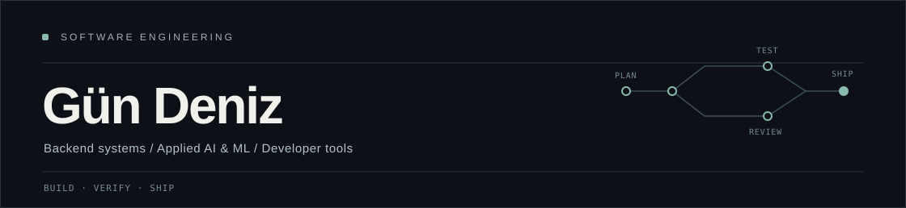

  

  <a href="https://linkedin.com/in/g%C3%BCn-deniz-039654298">LinkedIn</a> &nbsp;·&nbsp;
  <a href="mailto:okkahaitemp@gmail.com">Email</a> &nbsp;·&nbsp;
  <a href="#selected-work">Selected work</a>

I build **backend systems, developer tools, and applied AI software** — with an emphasis on correctness, useful abstractions, and behavior that can be tested rather than assumed.

I'm a part-time software developer at **ANDRITZ**, working with **C#/.NET and Python**. Outside work, I explore distributed systems, autonomous coding workflows, full-stack products, and machine learning.

## Selected work

<table>
  <tr>
    <td width="50%" valign="top">
      01 / DEVELOPER TOOLS
      <h3><a href="https://github.com/Okkahai/AgentOffice">AgentOffice</a></h3>
      
Runs real CLI coding agents in isolated Git worktrees. A dependency-aware task engine enforces verification, review, recoverable backups, and safe local merges.

      TypeScript · Node.js · SQLite · Git
        
      <a href="https://github.com/Okkahai/AgentOffice">Explore repository</a>
    </td>
    <td width="50%" valign="top">
      02 / BACKEND &amp; OBSERVABILITY
      <h3><a href="https://github.com/Okkahai/SREAgent">OpsPilot</a></h3>
      
Evidence-first incident investigation with OpenTelemetry ingestion, deterministic alert rules, traceable hypotheses, and approval-gated remediation proposals.

      Python · FastAPI · Celery · PostgreSQL · Redis
        
      <a href="https://github.com/Okkahai/SREAgent">Explore repository</a>
    </td>
  </tr>
  <tr>
    <td width="50%" valign="top">
      03 / FULL-STACK &amp; ALGORITHMS
      <h3><a href="https://github.com/Okkahai/Alibi">Alibi</a></h3>
      
A daily detective logic game. Its deterministic case generator and constraint solver require one provable solution, with clue-driven hints and reproducible cases.

      TypeScript · Next.js · Zod · Vitest
        
      <a href="https://github.com/Okkahai/Alibi">Explore repository</a> · <a href="https://github.com/Okkahai/Alibi/blob/main/shots3/d-hints.png">UI preview</a>
    </td>
    <td width="50%" valign="top">
      04 / MACHINE LEARNING
      <h3><a href="https://github.com/sssseaurchin/AI-Information-Detection">AI Information Detection</a></h3>
      
University team project detecting AI-generated content. My image-classification work covers model backbones, data leakage audits, calibration, and robustness evaluation.

      Python · TensorFlow/Keras · Docker
        
      <a href="https://github.com/sssseaurchin/AI-Information-Detection">Explore repository</a>
    </td>
  </tr>
</table>

**Also built:** [MarketOS](https://github.com/Okkahai/MarketOS) — a paper-trading and financial data platform with point-in-time data handling, deterministic risk controls, backtesting, and signal evaluation. *Simulation only; no real orders.*

## Toolbox

**Languages** &nbsp; Python · TypeScript · C# · SQL  
**Backend &amp; data** &nbsp; FastAPI · .NET · PostgreSQL · Redis · SQLite · Celery  
**Web &amp; infrastructure** &nbsp; React · Next.js · Docker · GitHub Actions · OpenTelemetry  
**ML** &nbsp; TensorFlow/Keras · computer vision · model evaluation and calibration

---

  <strong>Open to junior software engineering roles and internships in backend, platform, and applied AI/ML engineering.</strong>
   
  <a href="mailto:okkahaitemp@gmail.com">Get in touch</a> &nbsp;·&nbsp;
  <a href="https://github.com/Okkahai?tab=repositories">All repositories</a>

